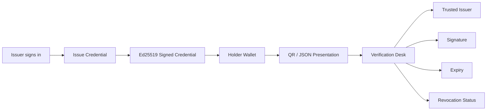

# D.I.C.E.

### Decentralized Identity Credentials Exchange

A lightweight academic credential platform for issuing, holding, presenting, and verifying signed student credentials.

<p align="center">
  <strong>Issue</strong> → <strong>Hold</strong> → <strong>Present</strong> → <strong>Verify</strong> → <strong>Revoke</strong>
</p>

<p align="center">
  <a href="#quick-start">Quick Start</a> ·
  <a href="#how-it-works">How It Works</a> ·
  <a href="#evaluation-demo">Evaluation Demo</a> ·
  <a href="#limitations">Limitations</a>
</p>

---

<a id="how-it-works"></a>

## How It Works



D.I.C.E. demonstrates how an institution can issue a digitally signed student-status credential, how a holder can retain it locally, and how a verifier can independently check it.

## ✨ Core Features

- Server-side Ed25519 signing
- Deterministic credential serialization
- Supabase Auth issuer authorization
- Public credential verification
- Tamper detection
- Expiry and student-status validation
- Issuer-controlled revocation
- QR generation, scanning, upload, and paste fallback
- Strict request validation and CORS protection
- Minimal database storage
- No complete credential payloads or private keys stored in PostgreSQL

## 🧱 Architecture

```text
React + Vite
├── Issuer Administration
├── Holder Wallet
└── Verification Desk
        │
        ▼
Supabase
├── Auth
├── PostgreSQL
│   ├── issuers
│   └── credential_status
└── Edge Functions
    ├── issue-credential
    ├── verify-credential
    └── revoke-credential
```

### Technology Stack

`React` · `TypeScript` · `Vite` · `Supabase` · `PostgreSQL` · `Web Crypto` · `Ed25519` · `QRCode` · `jsQR`

## 👥 Application Roles

| Issuer | Holder | Verifier |
|---|---|---|
| Authenticated registrar portal | Browser-based credential wallet | Public verification desk |
| Issues signed credentials | Stores credentials locally | Checks credential authenticity |
| Revokes credentials | Presents QR or JSON | Checks expiry and revocation |

## 📜 Credential Model

D.I.C.E. uses a minimal student-status credential:

```json
{
  "type": "StudentCredential",
  "issuerId": "svce-demo",
  "subject": {
    "id": "student-reference"
  },
  "claims": {
    "studentStatus": "active"
  },
  "proof": {
    "type": "Ed25519Signature",
    "keyId": "svce-demo-key-v1",
    "signature": "..."
  }
}
```

The signature covers the credential data but excludes the `proof` object itself.

## ✅ Verification Checks

The verifier checks:

- Trusted and active issuer
- Matching issuer key
- Ed25519 signature
- Expiry date
- Student-status claim
- Credential registration
- Revocation status
- Issuer ownership of the status record

A revoked credential remains cryptographically signed, but verification fails because the status registry reports it as revoked.

<a id="quick-start"></a>

## 🚀 Quick Start

### Requirements

- Node.js 20+
- npm
- Supabase project

### Install

```bash
npm install
cp .env.example .env
npm run dev
```

Configure `.env`:

```env
VITE_SUPABASE_URL=https://your-project.supabase.co
VITE_SUPABASE_PUBLISHABLE_KEY=your-publishable-key
```

Apply the migrations in:

```text
supabase/migrations/
```

Configure private signing keys and other server-only values through Supabase Edge Function secrets:

| Secret Name | Purpose | Example / Format |
| :--- | :--- | :--- |
| `ISSUER_PRIVATE_KEY` | Server Ed25519 private signing key (PKCS#8 Base64URL) | Base64URL string (keep strictly confidential) |
| `DICE_ISSUER_ID` | Registered issuer identifier | `svce-demo` |
| `DICE_ISSUER_KEY_ID` | Key identifier corresponding to registered public key | `svce-demo-key-v1` |
| `ALLOWED_ORIGIN` | Allowed origin(s) for CORS preflight and responses | `http://localhost:5173,https://your-domain.vercel.app` |
| `SUPABASE_URL` | Supabase API URL | `https://your-project.supabase.co` |
| `SUPABASE_SERVICE_ROLE_KEY` | Administrative service-role key (bypasses RLS) | Supabase service-role JWT |
| `SUPABASE_DB_URL` | Direct PostgreSQL connection string | Postgres connection URI |

> Never place private keys, service-role keys, passwords, access tokens, or complete `.env` files in the repository.

### Available Commands

```bash
npm run dev       # Start development server
npm run build     # Create production build
npm run test      # Run automated tests
npm run lint      # Run lint checks
npm run preview   # Preview production build
```

<a id="evaluation-demo"></a>

## 🎬 Evaluation Demo

1. Sign in using the dedicated demo issuer account.
2. Issue a student credential.
3. Open Holder Wallet.
4. Present the credential through QR.
5. Verify it in Verification Desk.
6. Run the tamper test.
7. Revoke the credential.
8. Verify again and observe the rejection.

Evaluator credentials should be shared privately and never committed to GitHub.

## 🛡️ Security Principles

- Private signing keys remain server-side.
- Issuer authorization uses Supabase `app_metadata`.
- Complete credentials are not stored in PostgreSQL.
- Direct database mutations are restricted.
- Verification is public for the MVP.
- QR payloads are processed in browser memory.
- Credentials are stored locally for the prototype wallet.
- The frontend never receives server-only secrets.

<a id="limitations"></a>

## ⚠️ Limitations

- Browser storage is not a production wallet.
- The complete credential is presented to the verifier.
- Selective disclosure and zero-knowledge proofs are not implemented.
- Blockchain issuer registry integration is not implemented.
- The issuer is a simulated academic authority.
- The credential format does not claim full W3C Verifiable Credential compliance.
- The MVP currently uses one configured demo issuer.

## 📁 Project Structure

```text
src/
├── features/
│   ├── issuer/
│   ├── wallet/
│   └── verifier/
├── lib/
│   ├── qr/
│   └── supabase/
├── types/
└── App.tsx

supabase/
├── functions/
│   ├── issue-credential/
│   ├── verify-credential/
│   ├── revoke-credential/
│   └── _shared/
└── migrations/
```

## Project Status

The core lifecycle is implemented:

```text
Issue → Store → Present → Verify → Revoke → Reject
```

D.I.C.E. is an MVP demonstration of signed, user-held academic credentials—not a production identity infrastructure system.
